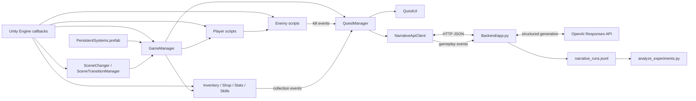
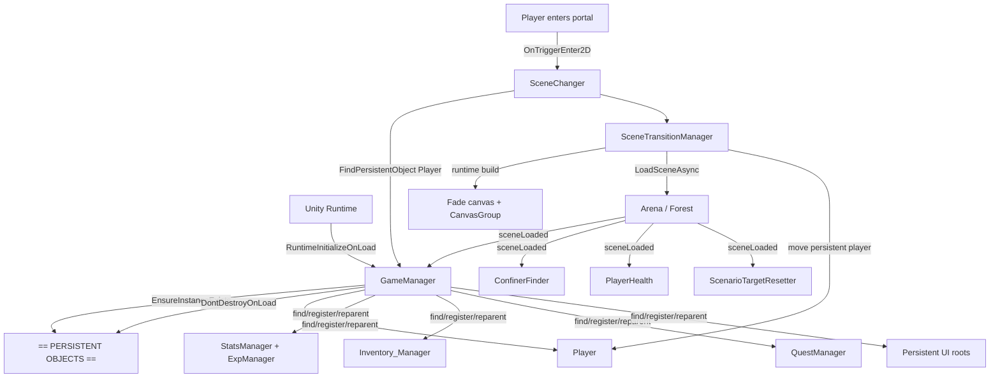
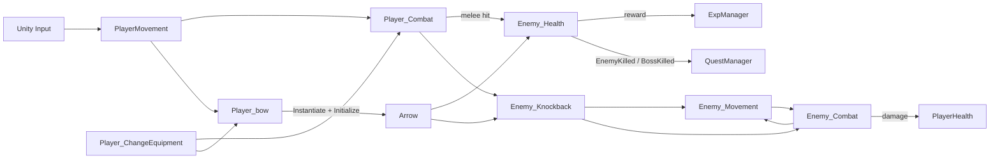
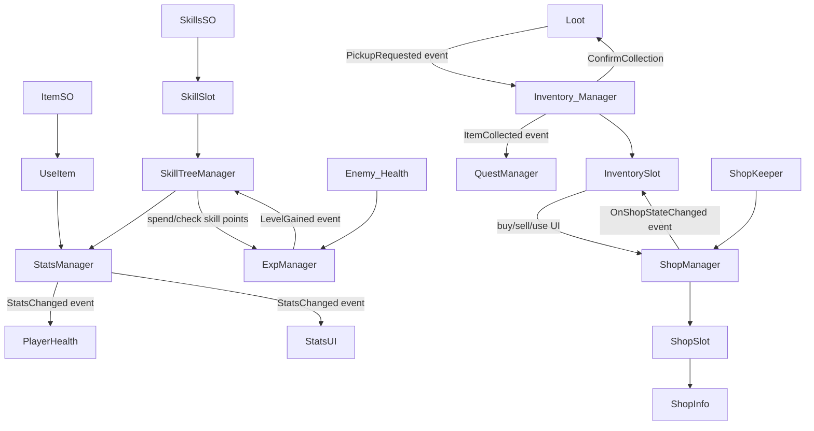
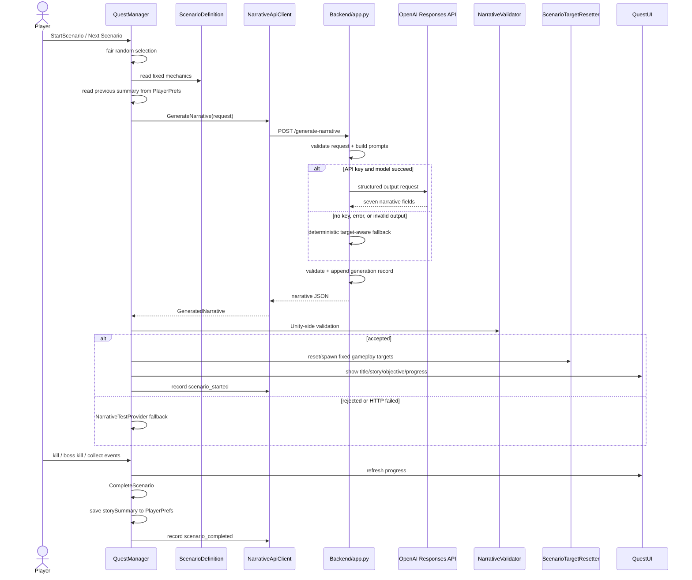
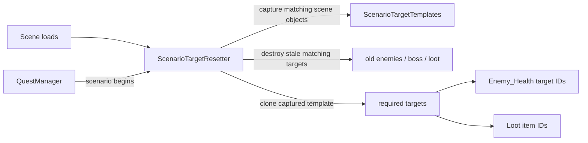
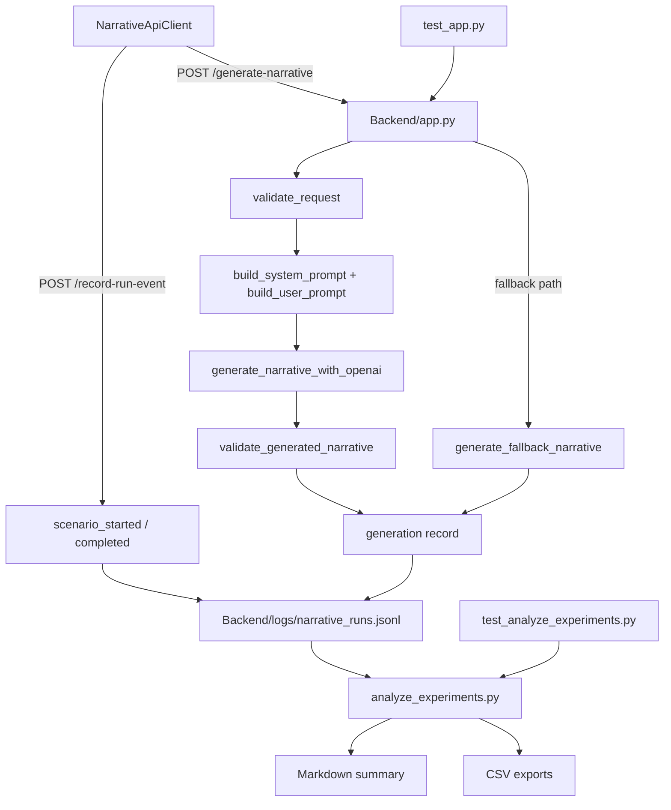

# LLMQuestPrototype 程式關係總覽

更新日期：2026-08-10

這份文件的目標不是逐行解釋程式，而是回答四個實際問題：

1. 某支程式是由誰啟動或呼叫？
2. 它又會呼叫、修改或通知誰？
3. 關係是 C# 直接呼叫、Inspector 引用、事件，還是 Unity 自動回呼？
4. 發生錯誤時，應從哪一支程式開始追？

## 為什麼 Unity 程式關係特別難讀

是的，這通常是 Unity 專案最頭痛的部分之一。一般程式多半可以沿著函式呼叫一路追；Unity 還同時存在以下連線：

| 符號 | 關係 | 例子 |
|---|---|---|
| `A → B` | C# 直接呼叫或存取 | `QuestManager → NarrativeValidator` |
| `A ⇢ B` | Inspector / SerializedField 引用 | `QuestManager ⇢ ScenarioDefinition` |
| `A ⚡ B` | 事件通知，不是直接呼叫 | `Enemy_Health ⚡ QuestManager` |
| `Unity ↪ A` | Unity lifecycle、Trigger、Collision、Animation Event | `Unity ↪ Loot.OnTriggerEnter2D` |
| `Scene/Prefab ⊃ A` | 程式掛在場景或 Prefab 物件上 | `PersistentSystems ⊃ GameManager` |
| `A ⇄ HTTP ⇄ B` | Unity 與 Backend 跨程序通訊 | `NarrativeApiClient ⇄ app.py` |

因此「搜尋誰呼叫這個 method」只能看到其中一部分。Inspector、場景 YAML、事件訂閱及 Unity callback 都必須一起看。

## 一頁式總架構

## 1. 啟動、Persistent Objects 與場景切換

重點：

- `GameManager` 是全專案最早啟動的總入口，也是 Persistent Object 註冊中心。
- `SceneChanger` 只代表某一個傳送門；實際淡入淡出與非同步載入由 runtime 建立的 `SceneTransitionManager` 執行。
- `Confiner` 應保持場景專屬。換場景後，`ConfinerFinder` 讓 persistent camera 重新找到新場景的邊界。
- Scene 裡若存在重複的 persistent root，`GameManager` 會保留既有版本並清理 duplicate，避免兩套 Player/UI/Manager 同時運作。

## 2. 玩家、弓箭與敵人戰鬥

重點：

- 玩家移動、近戰、弓箭是三支分開的程式；`PlayerMovement` 負責輸入狀態協調。
- 箭矢是 `Player_bow` 動態生成的 `Arrow.prefab`，不是場景中固定存在。
- 近戰與箭矢最後都走到相同的 `Enemy_Health.ChangeHealth()` 與 `Enemy_Knockback`。
- 敵人死亡不直接呼叫 QuestManager；它發出 static event，讓 QuestManager 判斷當前 scenario 是否需要計數。

## 3. Stats、經驗、技能、Inventory 與商店

重點：

- `ItemSO`、`SkillsSO`、`ScenarioDefinition` 都是資料資產，不會自己執行；Manager 或 Slot 讀取它們。
- Stats 變更用事件同步血量與 Stats UI。
- 撿道具先由 `Loot` 發送請求，Inventory 確認有空間後才真正收集；這是一個防止滿背包仍把地上物品刪掉的重要流程。
- Quest 的 Collect scenario 監聽 Inventory 成功收進道具後的 `ItemCollected`，不是只看 Player 碰到物品。

## 4. Quest 與 LLM 敘事完整流程

LLM 的權限邊界：

- Unity 決定 scenario type、target ID、數量、敵人能力、地圖事實與 rewards。
- LLM 只生成 title、introduction、顯示名稱、completion text 與 story summary。
- Backend 與 Unity 都各驗證一次；真正的遊戲進度永遠使用 `ScenarioDefinition.requiredAmount`，不解析 LLM 寫的句子。

## 5. 任務目標的重生與動態生成

`ScenarioTargetTemplates` 是刻意隱藏在 Hierarchy 的 runtime template container。它保留場景中原始敵人、Boss、蘑菇的位置與元件設定，讓下一個 scenario 可以重生正確目標；它不是 LLM 生成的物件。

## 6. Backend、實驗紀錄與分析

每次完整遊戲任務通常對應三筆 JSONL：

1. `generation`：prompt input、模型輸出、驗證、token、成本與 latency。
2. `scenario_started`：Unity 已接受敘事並開始 gameplay。
3. `scenario_completed`：玩家完成、耗時與最後進度。

因此「紀錄筆數」不等於「故事生成次數」。分析器會用 `requestId` 將三筆資料 join 成同一次 run。

## 程式逐支索引

### A. 核心、場景與環境

| 程式 | 掛載／入口 | 被誰引用或觸發 | 主要呼叫／影響 |
|---|---|---|---|
| `GameManager.cs` | `PersistentSystems` root；runtime initialization | Unity、`SceneChanger`、`ExpManager`、`PlayerHealth` | 建立 singleton、註冊 persistent objects、跨場景保留、清除 duplicate、提供 `FindPersistentObject` |
| `SceneChanger.cs` | Arena/Forest portal | Unity `OnTriggerEnter2D` | 找 persistent Player，呼叫內部 `SceneTransitionManager` |
| `SceneTransitionManager` | 由 `SceneChanger.cs` runtime 建立 | `SceneChanger` | 建 Fade UI、封鎖輸入、移動 Player、`LoadSceneAsync`、淡回透明、camera warp |
| `CameraFollow2D.cs` | Camera component | Unity | 跟隨 target；由 `ConfinerFinder` 找到並更新 target |
| `ConfinerFinder.cs` | Persistent Cameras | Unity `sceneLoaded` | 新場景載入後重新綁定 camera target 與 scene Confiner |
| `Elevation_Entry.cs` | 場景 elevation trigger | Unity trigger | 調整 Player sorting/elevation 狀態 |
| `Elevation_Exit.cs` | 場景 elevation trigger | Unity trigger | 還原 Player sorting/elevation 狀態 |
| `AnimatedTile.cs` | Tile asset | Unity Tilemap renderer | 回傳動畫 tile frames、速度與 transform |

### B. 玩家與戰鬥

| 程式 | 掛載／入口 | 被誰引用或觸發 | 主要呼叫／影響 |
|---|---|---|---|
| `PlayerMovement.cs` | Persistent Player | Unity `Update/FixedUpdate`、Enemy knockback | Rigidbody 移動、方向、Animator；協調 melee/bow 是否允許移動 |
| `PlayerHealth.cs` | Persistent Player | `Enemy_Combat`、`StatsChanged`、sceneLoaded | 扣血、治療、死亡/復原、同步 max health |
| `Player_Combat.cs` | Persistent Player | Input / `PlayerMovement` / equipment switch | 近戰動畫、Overlap/hit、呼叫 Enemy health/knockback |
| `Player_bow.cs` | Persistent Player | Input / `PlayerMovement` / equipment switch | aim Blend Tree、Instantiate Arrow、初始化方向/傷害 |
| `Player_ChangeEquipment.cs` | Persistent Player | Unity input | 在 sword/bow 間切換並開關對應程式/視覺 |
| `Arrow.cs` | `Arrow.prefab` runtime instance | `Player_bow` | 飛行、碰撞、Enemy damage/knockback、attach/destroy |
| `Enemy_Movement.cs` | enemy/boss scene target | Unity update、Enemy combat/knockback | 尋敵、追逐、方向、attack state、knockback state |
| `Enemy_Combat.cs` | enemy/boss scene target | `Enemy_Movement`、Animation Event | 攻擊流程、呼叫 `PlayerHealth`、中斷/結束攻擊 |
| `Enemy_Knockback.cs` | enemy/boss scene target | Arrow、Player melee | 暫停 Enemy movement/combat 並施加擊退 |
| `Enemy_Health.cs` | enemy/boss scene target | Arrow、Player melee | HP、死亡、EXP、drop、發出 EnemyKilled/BossKilled |

### C. Stats、經驗與技能

| 程式 | 掛載／入口 | 被誰引用或觸發 | 主要呼叫／影響 |
|---|---|---|---|
| `StatsManager.cs` | Persistent StatsManager | items、skills、Player、UI | 所有主要數值；發出 `StatsChanged` |
| `ExpManager.cs` | Persistent StatsManager | Enemy death、Quest reward、SkillTree | EXP/level/skill points；發出 `LevelGained` |
| `StatsUI.cs` | Persistent Stats panel | `StatsChanged` | 將 StatsManager 數值刷新到 UI |
| `SkillsSO.cs` | ScriptableObject asset | `SkillSlot`、`StatsManager` | 儲存技能名稱、cost、effect data；不主動執行 |
| `SkillTreeManager.cs` | Persistent SkillsCanvas | `SkillSlot`、`LevelGained` | 技能購買、skill point、套用 effect、發出 `SkillPurchased` |
| `SkillSlot.cs` | `SkillButton.prefab` / SkillsCanvas | UI Button | 顯示技能、檢查 prerequisite、呼叫 SkillTreeManager |

### D. Inventory 與 Shop

| 程式 | 掛載／入口 | 被誰引用或觸發 | 主要呼叫／影響 |
|---|---|---|---|
| `ItemSO.cs` | ScriptableObject asset | Loot、Inventory、Shop、Stats | item ID、icon、value、stack/use effect；不主動執行 |
| `Loot.cs` | 場景物品 / `Loot_Prefab` | Unity trigger、Inventory callback | 發 `PickupRequested`；成功後播放 pickup 並刪除 |
| `Inventory_Manager.cs` | Persistent InventoryCanvas | Loot event、Slots、Shop、Quest reward | 背包資料、stack、buy/sell/use/drop；發 `ItemCollected` |
| `InventorySlot.cs` | `InventorySlot.prefab` | Inventory/Shop UI | 顯示 slot、點擊/拖放/買賣狀態 |
| `UseItem.cs` | Persistent InventoryCanvas | Inventory slot | 依 ItemSO effect 修改 StatsManager |
| `ShopKeeper.cs` | Arena shop NPC | Unity trigger/input | 開啟/關閉 ShopManager |
| `ShopManager.cs` | Persistent ShopCanvas | ShopKeeper、Slots | 商品清單、買賣、金錢、pause/UI state；發 `OnShopStateChanged` |
| `ShopSlot.cs` | `ShopSlot.prefab` | ShopManager/UI | 顯示商品、選取並請求 buy/sell |
| `ShopInfo.cs` | Shop info popup | ShopSlot | 顯示名稱、說明、價格等資訊 |

### E. Quest 與 LLM Unity 端

| 程式 | 掛載／入口 | 被誰引用或觸發 | 主要呼叫／影響 |
|---|---|---|---|
| `ScenarioDefinition.cs` | Scenario ScriptableObject | QuestManager、Validator、Resetter、request DTO | 固定玩法：type、target、amount、reward、能力/地圖描述 |
| `GeneratedNarrative.cs` | Serializable DTO | API client、Validator、QuestManager、fallback | 七個 LLM 敘事欄位 |
| `NarrativeGenerationRequest.cs` | Serializable DTO | QuestManager、API client | Unity 傳給 Backend 的固定 scenario facts、continuity、tone |
| `NarrativeApiClient.cs` | Persistent QuestSystem | QuestManager | POST 生成與 gameplay event，JSON serialize/deserialize、timeout/error callback |
| `NarrativeValidator.cs` | static utility | QuestManager | 檢查空值、長度、正確 required amount、建立安全 objective |
| `NarrativeTestProvider.cs` | Persistent QuestSystem | QuestManager | Backend 不可用或回傳不合法時的本地敘事 fallback |
| `QuestManager.cs` | Persistent QuestSystem | UI、enemy/item events、GameManager | 隨機 scenario、API request、驗證、進度、完成、獎勵、PlayerPrefs continuity、experiment events |
| `QuestUI.cs` | Persistent QuestSystem | QuestManager event | runtime 建立/綁定 QuestCanvas，展開收合，顯示 loading/active/completed |
| `ScenarioTargetResetter.cs` | Persistent QuestSystem | QuestManager、sceneLoaded | 捕捉 scene templates、清舊目標、依 scenario 重生正確數量 |

### F. Backend 與研究工具

| 程式 | 入口 | 被誰呼叫 | 主要呼叫／輸出 |
|---|---|---|---|
| `Backend/app.py` | `python Backend/app.py` | NarrativeApiClient HTTP | 驗證 request、建 prompts、OpenAI structured output、fallback、JSONL logging、health endpoint |
| `Backend/analyze_experiments.py` | command line | 研究者 | 讀 JSONL、join requestId、統計成功率/fallback/latency/cost/completion/repetition，輸出 Markdown/CSV |
| `Backend/test_app.py` | unittest | 測試執行器 | 測 request/output/event validation、fallback、record schema |
| `Backend/test_analyze_experiments.py` | unittest | 測試執行器 | 測 JSONL 分類、join、統計與 repetition analysis |

## Static event 對照表

| Publisher | Event | Subscriber | 用途 |
|---|---|---|---|
| `Enemy_Health` | `EnemyKilled` | `QuestManager` | KillEnemies 進度 |
| `Enemy_Health` | `BossKilled` | `QuestManager` | SlayBoss 進度 |
| `Loot` | `PickupRequested` | `Inventory_Manager` | 背包確認容量後才收取 |
| `Inventory_Manager` | `ItemCollected` | `QuestManager` | CollectItems 進度 |
| `StatsManager` | `StatsChanged` | `PlayerHealth`, `StatsUI` | 數值與 UI 同步 |
| `ExpManager` | `LevelGained` | `SkillTreeManager` | 升級後增加/更新技能點 |
| `ShopManager` | `OnShopStateChanged` | `InventorySlot` | 切換 slot 的 shop 操作狀態 |
| `QuestManager` | `QuestStateChanged` | `QuestUI` | loading、進度、完成 UI 刷新 |
| `SkillTreeManager` | `SkillPurchased` | 其他 UI/observer 可訂閱 | 技能購買通知 |

## Inspector / Asset 關係（程式搜尋最容易漏掉）

| Owner | Inspector / Asset reference |
|---|---|
| `QuestManager` | available `ScenarioDefinition[]`、NarrativeApiClient、NarrativeTestProvider、ScenarioTargetResetter、UI texts/button |
| `ScenarioTargetResetter` | scene 中帶 target ID 的 Enemy_Health / Loot objects |
| `Player_bow` | Arrow prefab、Animator、launch point、PlayerMovement |
| `Inventory_Manager` | ItemSO registry、InventorySlot objects、Loot prefab |
| `ShopManager` | ShopSlot prefab、ItemSO catalog、Inventory_Manager |
| `SkillTreeManager` | SkillSlot objects、ExpManager、StatsManager |
| `GameManager` | 通常由 runtime 掃描核心型別與指定名稱 root；不依賴手動大清單 |

## 建議閱讀順序

如果要為 presentation 讀懂整個專案，不要照檔名順序。建議：

1. `GameManager.cs`：先理解哪些物件會跨場景。
2. `SceneChanger.cs` + `ConfinerFinder.cs`：理解換場景後 Player、Camera 怎麼接回去。
3. `PlayerMovement.cs` → `Player_Combat.cs` / `Player_bow.cs` → Enemy 四支程式。
4. `StatsManager.cs` + `ExpManager.cs`，再讀 Inventory 與 Skill。
5. `ScenarioDefinition.cs` → `QuestManager.cs` → `NarrativeApiClient.cs`。
6. `Backend/app.py`：從 HTTP handler 進入，再看 validation、prompt、OpenAI、fallback、logging。
7. `analyze_experiments.py`：最後理解研究資料如何由 runtime record 變成結果。

## 除錯時從哪裡開始

| 症狀 | 第一支看 | 接著看 |
|---|---|---|
| 換場景後 Player/UI 消失或重複 | `GameManager.cs` | `PersistentSystems.prefab`, `SceneChanger.cs` |
| 換場景後 camera 超出地圖 | `ConfinerFinder.cs` | 新場景 Confiner tag/collider |
| 攻擊動畫有播但沒傷害 | `Player_Combat.cs` / `Player_bow.cs` | `Arrow.cs`, `Enemy_Health.cs`, collider/layer |
| 敵人死了任務不加進度 | `Enemy_Health.cs` events | `QuestManager` subscriptions、targetId |
| 撿到物品但 Collect 不加進度 | `Inventory_Manager.ItemCollected` | `Loot.itemId`, scenario targetId |
| 任務目標沒有重生／數量錯 | `ScenarioTargetResetter.cs` | captured templates、ScenarioDefinition amount/targetId |
| 一直使用本地故事 | `NarrativeApiClient.cs` | Backend terminal、`app.py` fallbackReason、API key/credits |
| LLM 改了數量或資料不合法 | `NarrativeValidator.cs` | Backend `validate_generated_narrative`、prompt |
| JSONL 三筆看起來像三次生成 | `requestId` | `recordType` 與 `eventType` |
| Skills 換場景後遺失 | `GameManager` persistent registration | `SkillTreeManager` runtime state / save design |

## 最重要的六個 Hub

1. `GameManager`：物件生命週期與跨場景 ownership。
2. `QuestManager`：scenario、LLM、gameplay event、continuity 與 reward 的交會點。
3. `StatsManager`：角色數值的 single source of truth。
4. `Inventory_Manager`：所有 item ownership 與 Collect quest 的交會點。
5. `PlayerMovement`：玩家輸入、移動與攻擊狀態的協調點。
6. `Backend/app.py`：LLM、fallback、validation、usage、experiment log 的服務邊界。

這六支先理解，就能掌握大多數跨系統問題；其餘程式多半是資料、呈現或其中一段具體行為。
